# A반 · 1주차

[전체 아카이브](../../../README.md) · [이 반·주차 실행 페이지](https://kisoon.github.io/creative-computing-games/?class=A&week=1#collection)

기존 10회차 수업 결과물입니다. 3주간 아카이브에서는 1주차로 분류합니다.

### 게임별 실행 링크와 실제 첫 화면

아래 이미지는 각 게임을 PC 브라우저(1280 × 800)에서 직접 실행해 캡처한 첫 화면입니다. 이미지를 클릭하면 해당 게임이 열립니다.

| 게임 / 버전 | 실제 실행 첫 화면 |
| --- | --- |
| [슈게임 · 뜨개질](https://kisoon.github.io/creative-computing-games/play.html?game=game-01) | [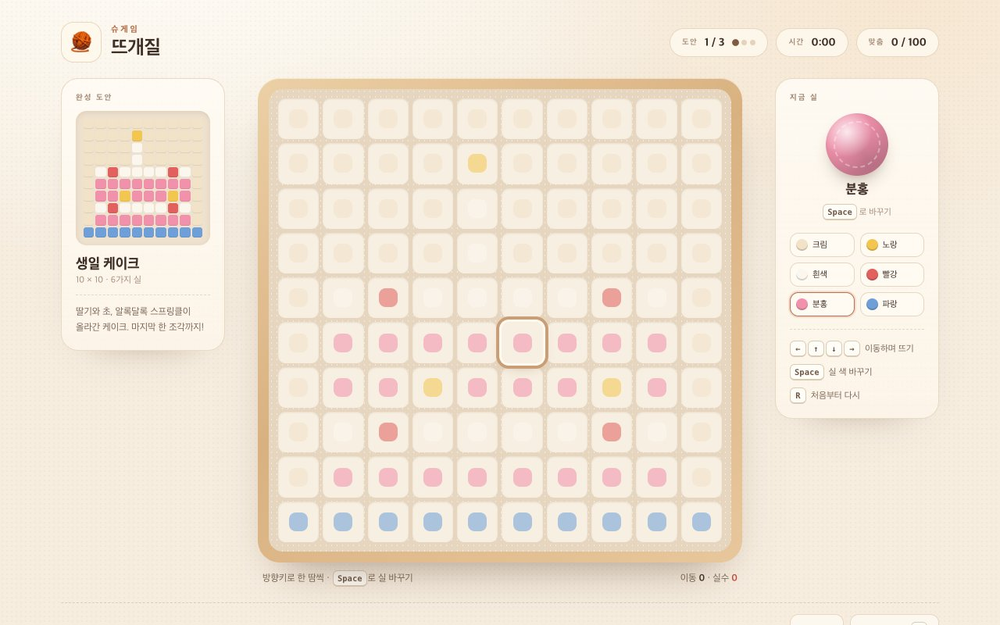](https://kisoon.github.io/creative-computing-games/play.html?game=game-01) |
| [Bubble Pop](https://kisoon.github.io/creative-computing-games/play.html?game=game-02) | [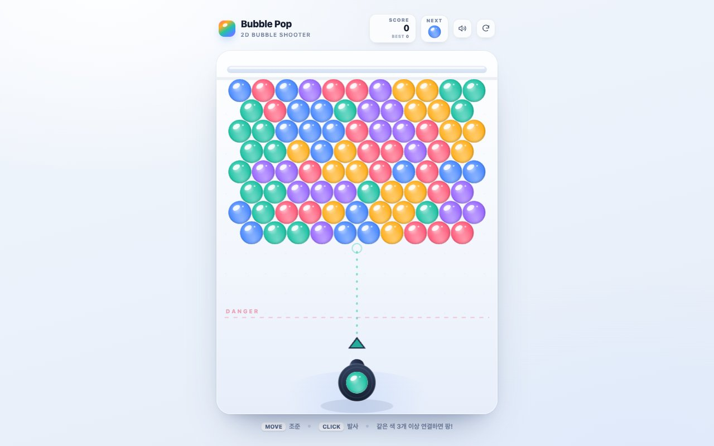](https://kisoon.github.io/creative-computing-games/play.html?game=game-02) |
| [LEMON TEN](https://kisoon.github.io/creative-computing-games/play.html?game=game-03) | [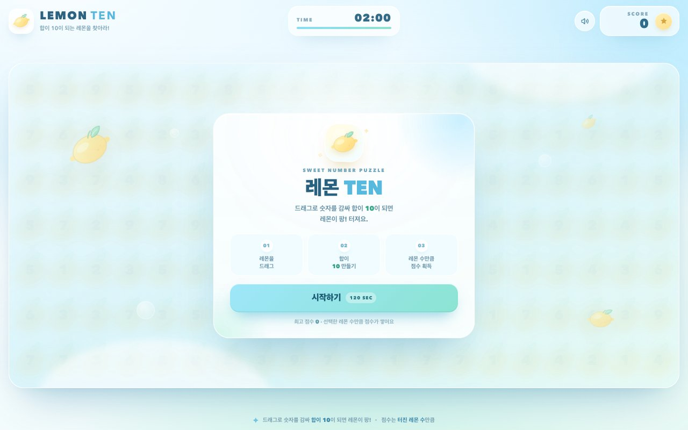](https://kisoon.github.io/creative-computing-games/play.html?game=game-03) |
| [해골 기사 · 대표 버전](https://kisoon.github.io/creative-computing-games/play.html?game=game-04) | [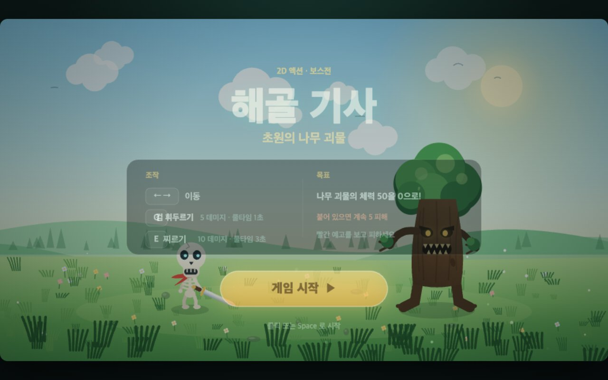](https://kisoon.github.io/creative-computing-games/play.html?game=game-04) |
| [해골 기사 · 미니 버전](https://kisoon.github.io/creative-computing-games/play.html?game=game-04&version=1) | [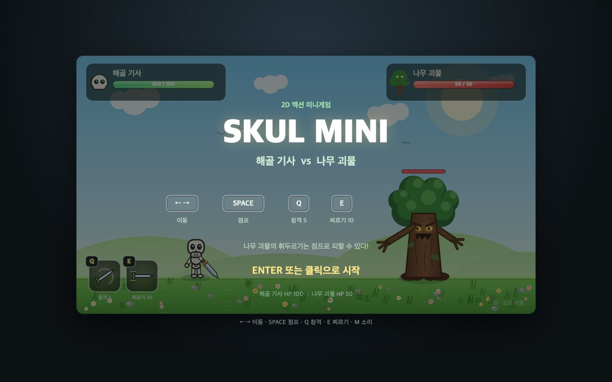](https://kisoon.github.io/creative-computing-games/play.html?game=game-04&version=1) |
| [해골 기사 · MVP 버전](https://kisoon.github.io/creative-computing-games/play.html?game=game-04&version=2) | [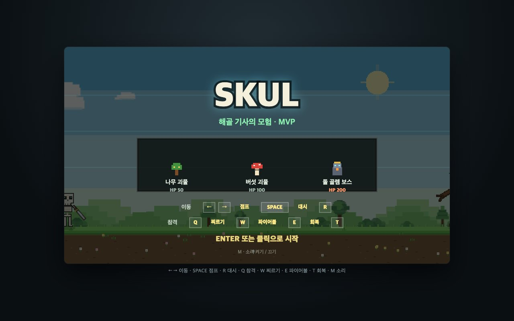](https://kisoon.github.io/creative-computing-games/play.html?game=game-04&version=2) |
| [장미와 모란](https://kisoon.github.io/creative-computing-games/play.html?game=game-05) | [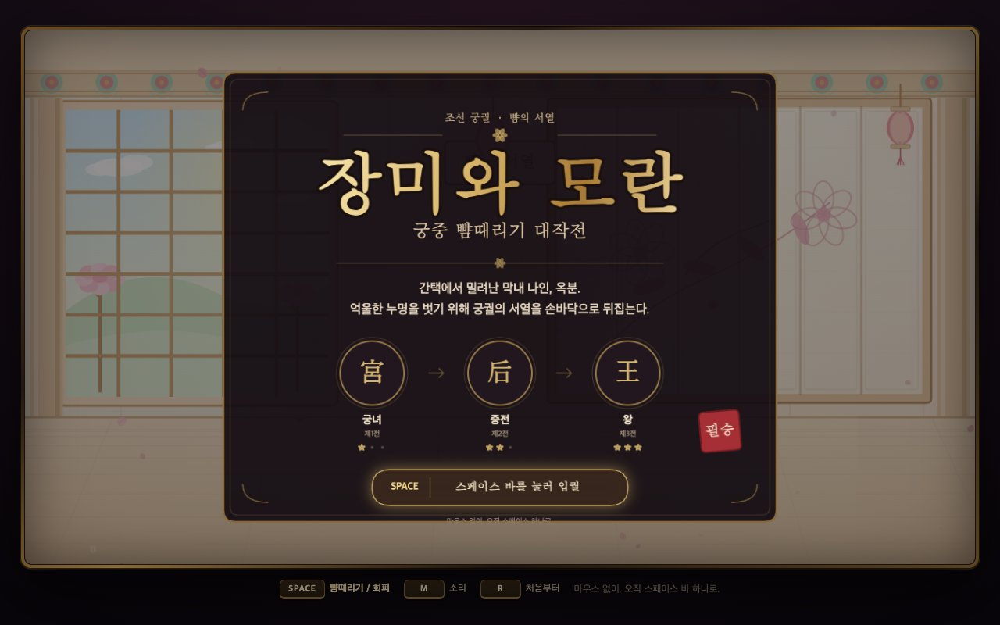](https://kisoon.github.io/creative-computing-games/play.html?game=game-05) |
| [NEON BEAT · 대표 버전](https://kisoon.github.io/creative-computing-games/play.html?game=game-06) | [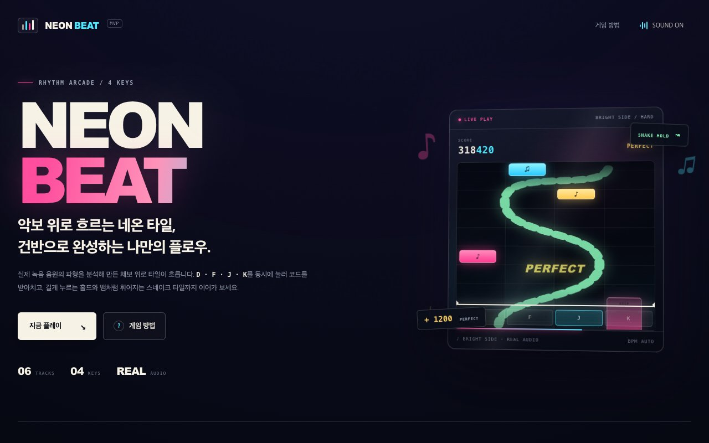](https://kisoon.github.io/creative-computing-games/play.html?game=game-06) |
| [NEON BEAT · 다른 제출 버전](https://kisoon.github.io/creative-computing-games/play.html?game=game-06&version=1) | [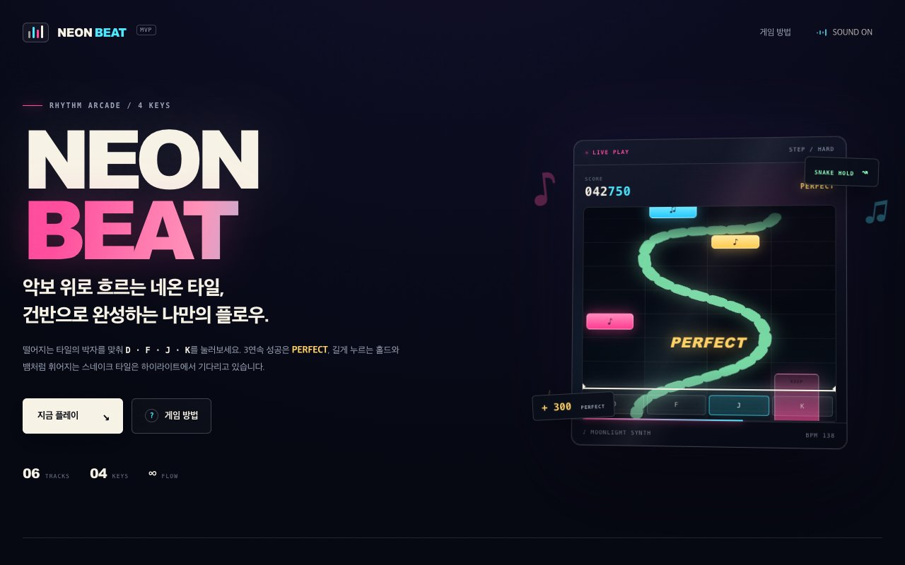](https://kisoon.github.io/creative-computing-games/play.html?game=game-06&version=1) |
| [물불 크로싱 · 대표 버전](https://kisoon.github.io/creative-computing-games/play.html?game=game-08) | [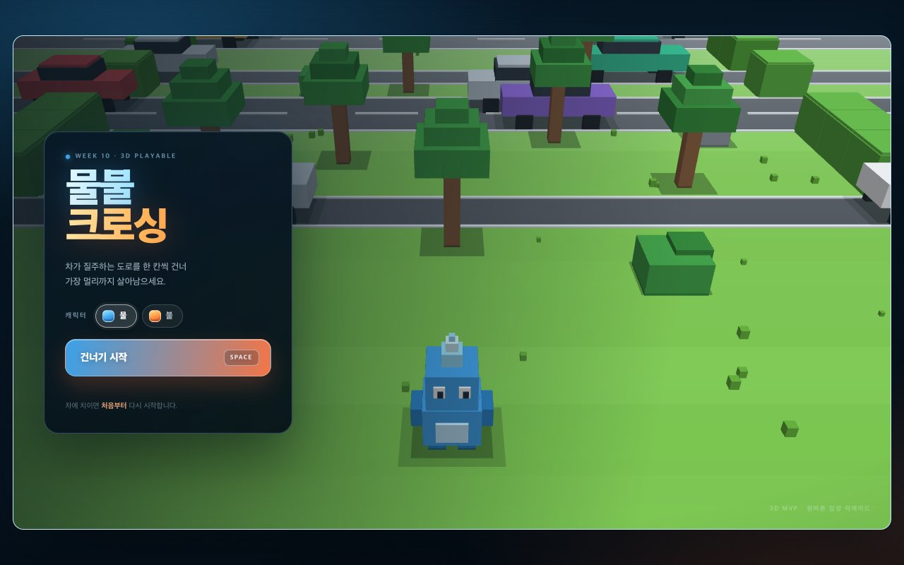](https://kisoon.github.io/creative-computing-games/play.html?game=game-08) |
| [물불 크로싱 · 물불 원정대 · 2D](https://kisoon.github.io/creative-computing-games/play.html?game=game-08&version=1) | [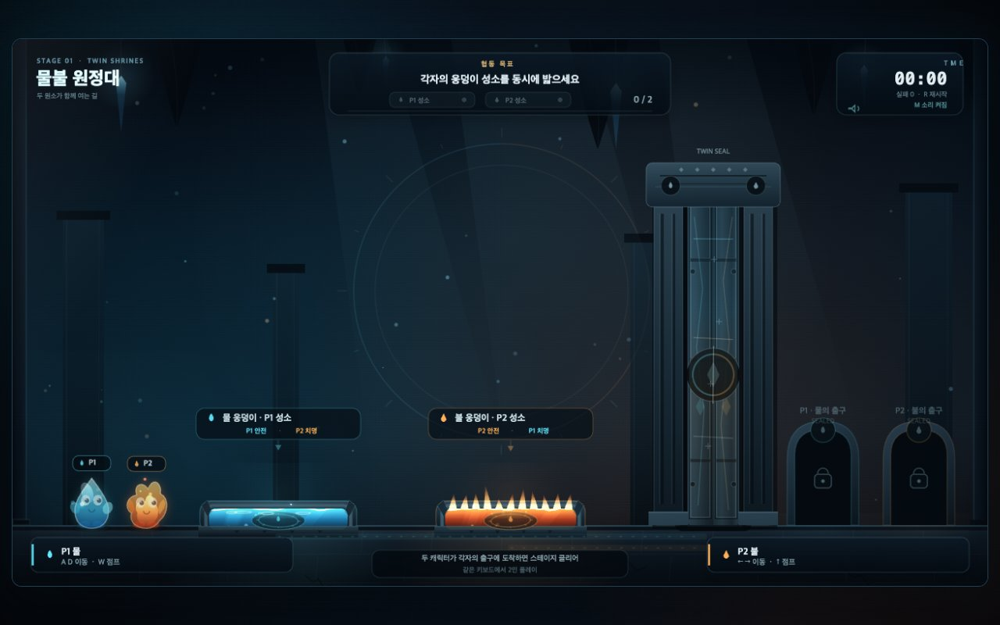](https://kisoon.github.io/creative-computing-games/play.html?game=game-08&version=1) |
| [지붕 위의 닌자](https://kisoon.github.io/creative-computing-games/play.html?game=game-09) | [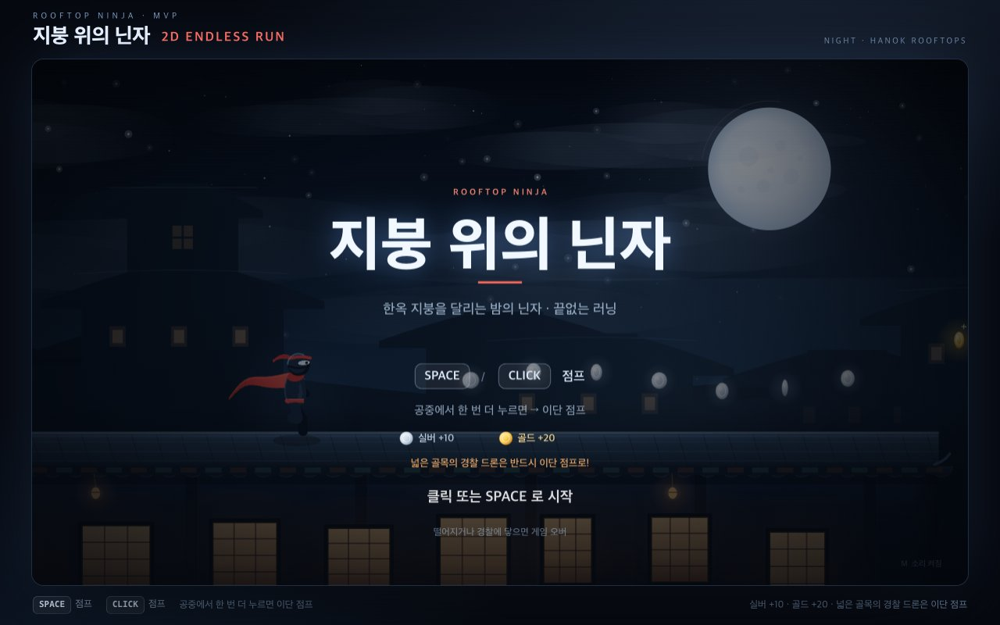](https://kisoon.github.io/creative-computing-games/play.html?game=game-09) |
| [달콤 옷장](https://kisoon.github.io/creative-computing-games/play.html?game=game-10) | [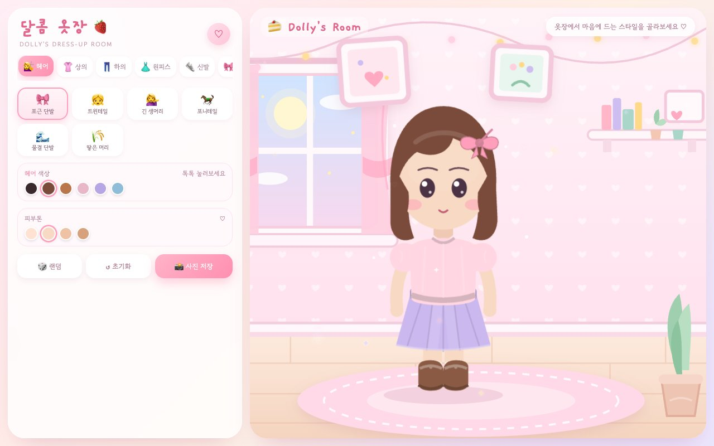](https://kisoon.github.io/creative-computing-games/play.html?game=game-10) |
| [숲길을 건너는 호랑이](https://kisoon.github.io/creative-computing-games/play.html?game=game-11) | [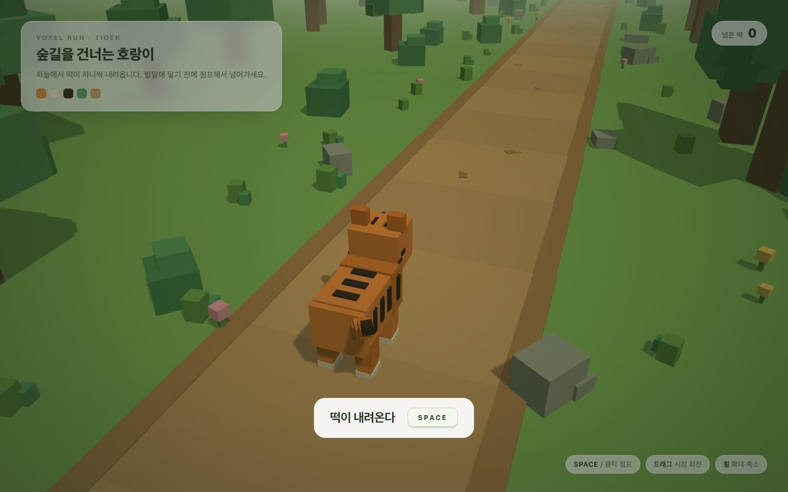](https://kisoon.github.io/creative-computing-games/play.html?game=game-11) |
| [고요한 호숫가](https://kisoon.github.io/creative-computing-games/play.html?game=game-12) | [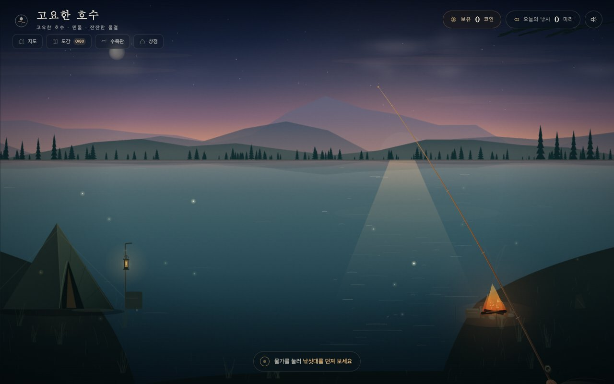](https://kisoon.github.io/creative-computing-games/play.html?game=game-12) |
| [GRAY BOX FIGHTERS](https://kisoon.github.io/creative-computing-games/play.html?game=fight) | [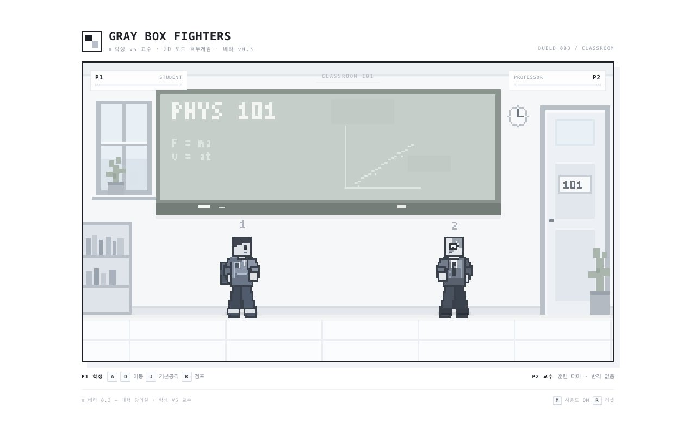](https://kisoon.github.io/creative-computing-games/play.html?game=fight) |

