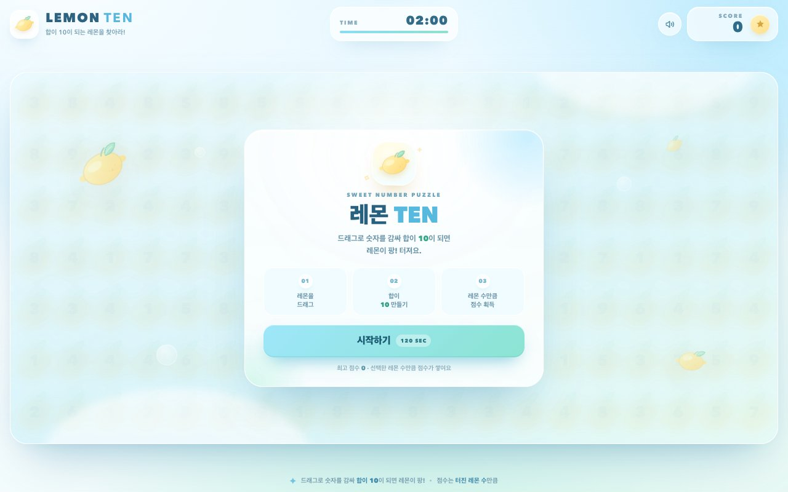
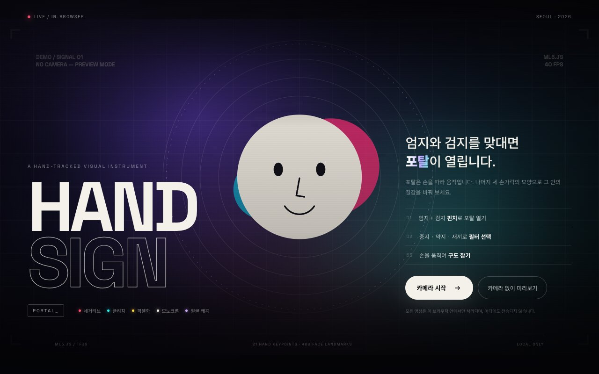
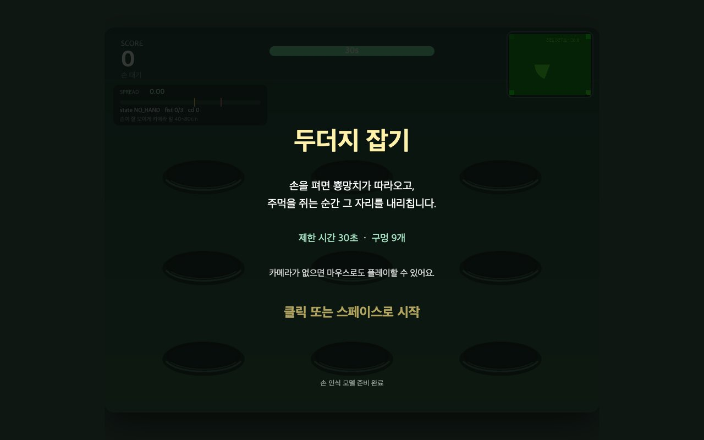
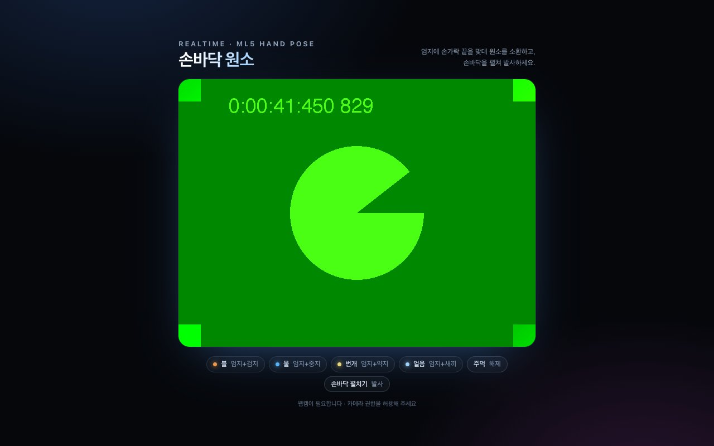
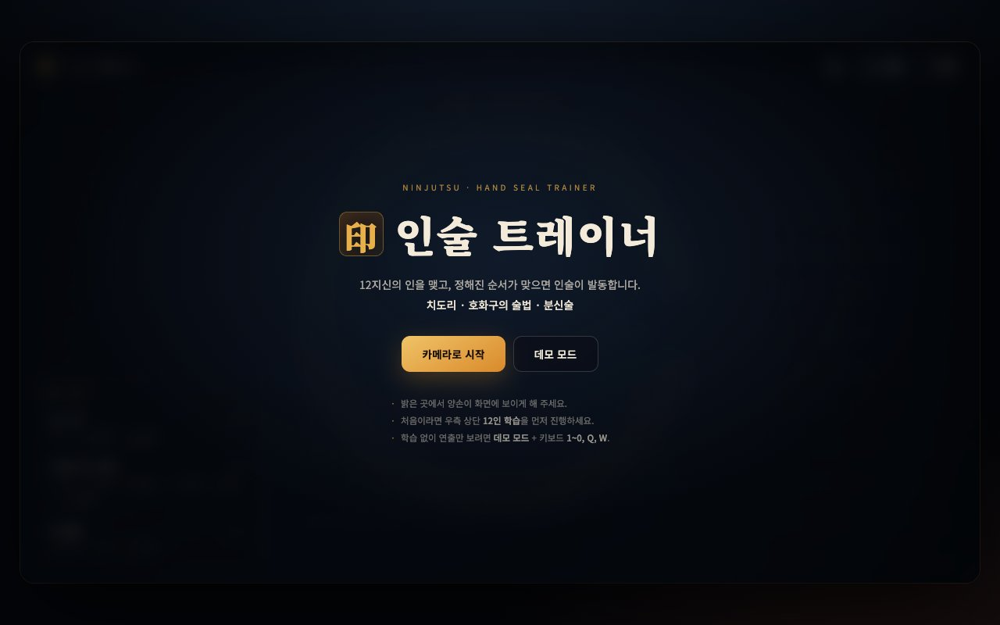
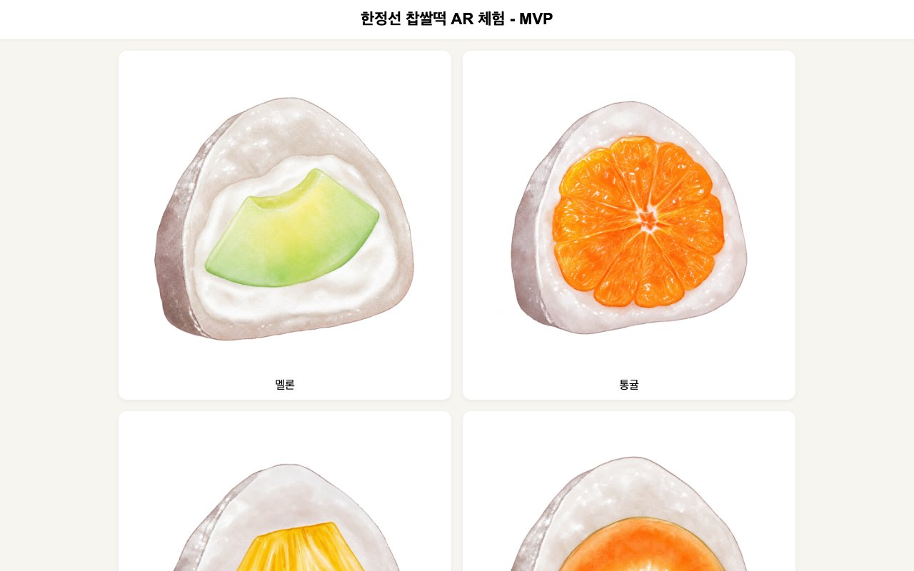

# A반 · 2주차 · 11회차

[전체 아카이브](../../../README.md) · [A반 2주차 체험하기](https://kisoon.github.io/creative-computing-games/?class=A&week=2#collection)

2026년도 2학기 서울예술대학 「창의컴퓨팅2」 수업의 바이브코딩 결과물입니다. 제출된 파일명에 다른 주차가 적혀 있는 경우에도 이번 11회차 제출 묶음 기준으로 분류했습니다.

11개 실행 프로젝트에서 12개 작품을 등록했습니다. 손 인식·카메라 작품은 PC Chrome/Edge와 카메라 권한이 필요하며, 외부 모델을 처음 불러올 때 시간이 걸릴 수 있습니다. 데모가 있는 작품은 카메라 없이도 체험할 수 있습니다.

| 작품 / 제작자 | 실행 화면 |
| --- | --- |
| [LEMON TEN · 레몬 텐](https://kisoon.github.io/creative-computing-games/play.html?game=a-week-02-lemon-ten) 이수빈 / 1조 마우스 드래그 |  |
| [HAND SIGN PORTAL](https://kisoon.github.io/creative-computing-games/play.html?game=a-week-02-hand-sign-portal) 김경빈 / 10조 카메라 · 손가락 제스처 / 데모 모드 |  |
| [손바닥 과일 받기](https://kisoon.github.io/creative-computing-games/play.html?game=a-week-02-palm-fruit) 김현경 카메라 · 손바닥 이동 |  |
| [손 인식 두더지 잡기](https://kisoon.github.io/creative-computing-games/play.html?game=a-week-02-hand-mole) 김민주 카메라 · 주먹 / 마우스 · Space |  |
| [말랑이 터치](https://kisoon.github.io/creative-computing-games/play.html?game=a-week-02-jelly-touch) 김수현 카메라 · 손동작 / 마우스 데모 |  |
| [손끝 마법](https://kisoon.github.io/creative-computing-games/play.html?game=a-week-02-fingertip-magic) 안다해 카메라 · 손동작 / K 시뮬레이션 |  |
| [손바닥 원소 · Hand Elements](https://kisoon.github.io/creative-computing-games/play.html?game=a-week-02-hand-elements) 김요한 · 최유찬 카메라 · 손가락 맞대기 · 손바닥 펼치기 |  |
| [印 · 인술 트레이너](https://kisoon.github.io/creative-computing-games/play.html?game=a-week-02-seal-trainer) 권태경 카메라 · 손 모양 / 데모 키보드 |  |
| [한정선 찹쌀떡 AR 체험](https://kisoon.github.io/creative-computing-games/play.html?game=a-week-02-mochi-ar) 황지민 카메라 · 카드 선택 · 체험 시작 · 화면 클릭 |  |
| [하늘빛 풍선 팡팡](https://kisoon.github.io/creative-computing-games/play.html?game=a-week-02-balloon-pop) 김단영 카메라 · 손끝 이동 (손 인식 후 시작) |  |
| [Pause Pose · 손으로 연주하는 악기](https://kisoon.github.io/creative-computing-games/play.html?game=a-week-02-pause-pose) 이현슬 카메라 · 손동작 · 연주 시작 |  |
| [모기 잡기](https://kisoon.github.io/creative-computing-games/play.html?game=a-week-02-mosquito) 이현슬 카메라 · 손뼉 / 데모 마우스 · Space |  |

## 활동기록 제출

박연희의 제출물은 AI 대화 활동기록(JSON)으로, 실행할 HTML·JavaScript 프로젝트 파일이 포함되어 있지 않아 실행 목록에는 추가하지 않았습니다. 실행 파일이 준비되면 같은 주차에 추가할 수 있습니다. 대화 원문은 공개하지 않습니다.

## 반영 및 점검

실행에 필요한 코드·이미지와 기존 크레딧 문서를 반영했습니다. 학번이 포함된 제출 파일명, AI 대화 원문, 별도 기획 문서와 중복 이미지 묶음은 공개 배포에 포함하지 않았습니다.

찹쌀떡 AR 제출 코드에서 실행을 막던 중복 변수 선언 한 줄만 제거했습니다. 모델 로더를 포함한 나머지 실행 파일은 원본과 일치합니다. 원본 ZIP은 변경하지 않았습니다. 손끝 마법의 프리뷰는 제출 코드에서 제공하는 K 시뮬레이션 모드로 캡처했습니다. 카메라 영상은 실물이 아닌 브라우저 가상 카메라로 로딩을 점검하며, 실제 손동작의 인식 정확도와 모든 기기의 동작은 검증 범위에 포함하지 않습니다.

12개 작품의 첫 화면과 로컬 파일 경로를 확인했습니다. 목록·장르 필터, 기존 1주차 분류, 모바일 배치, 플레이어 내 카메라 허용 설정, AR 클릭 반응, 마법 시뮬레이션 및 악기 버튼을 점검했습니다. 손바닥 원소는 가상 카메라에서 모델·카메라 시작까지 확인했습니다.

[표현 보존 검증 상세](VERIFICATION.md): 실행 파일 58개 중 57개 원본 일치, 1개 실행 오류 수정.
