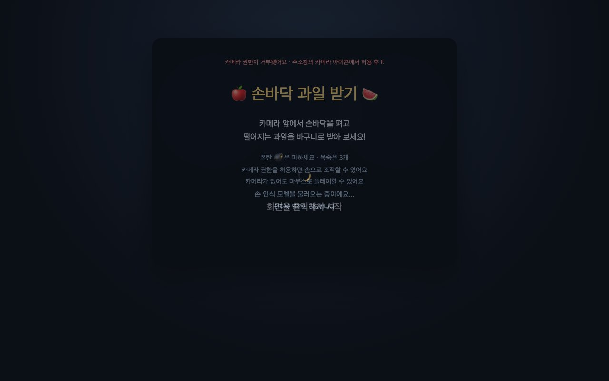
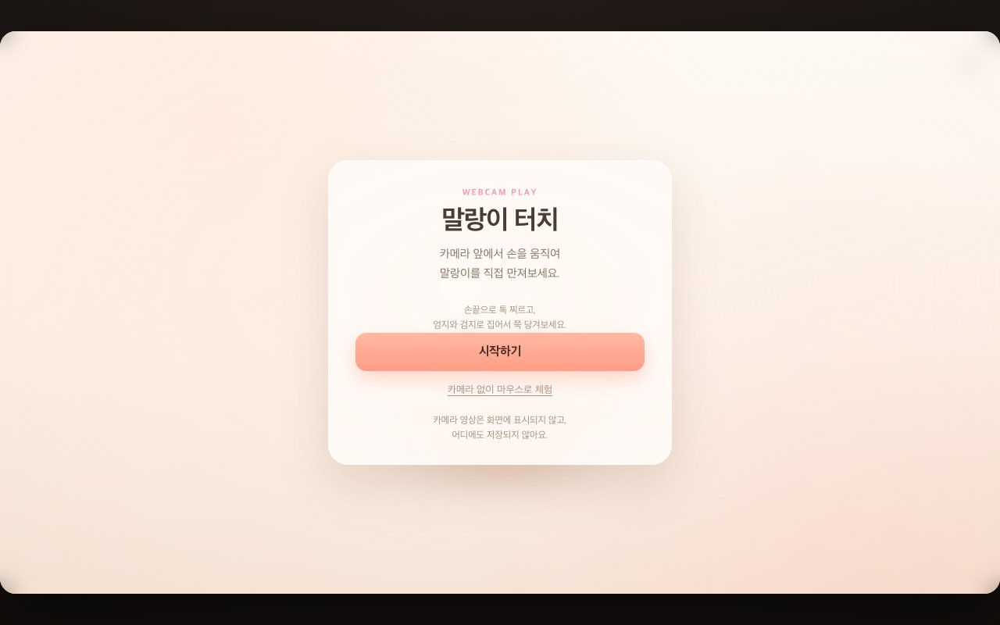
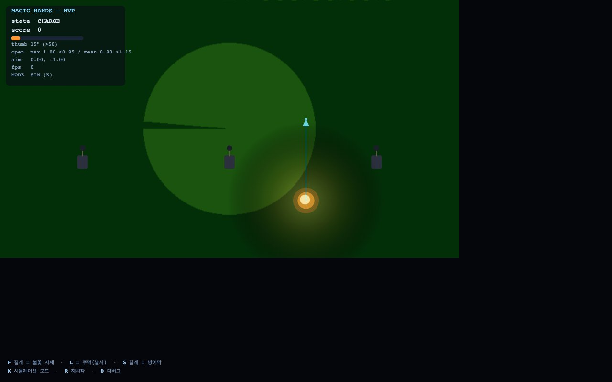
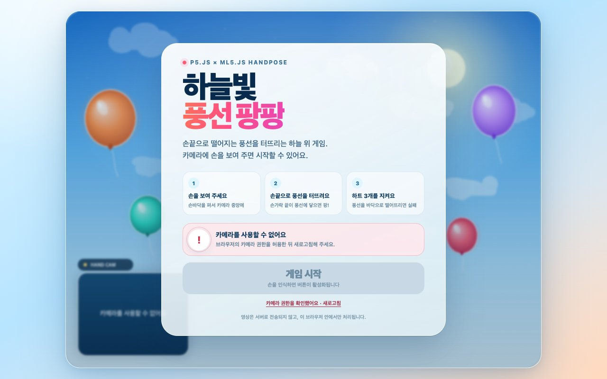
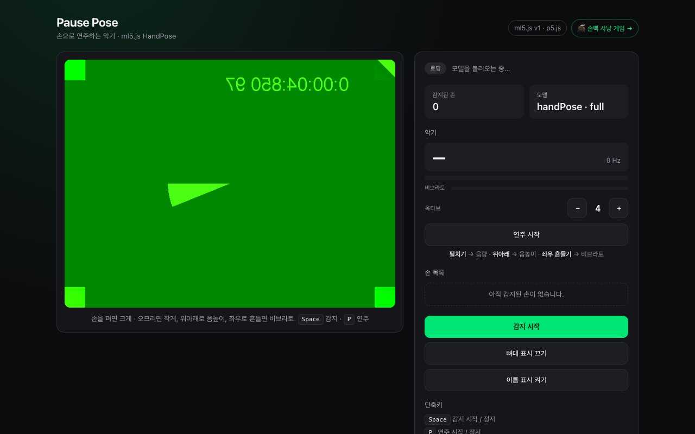
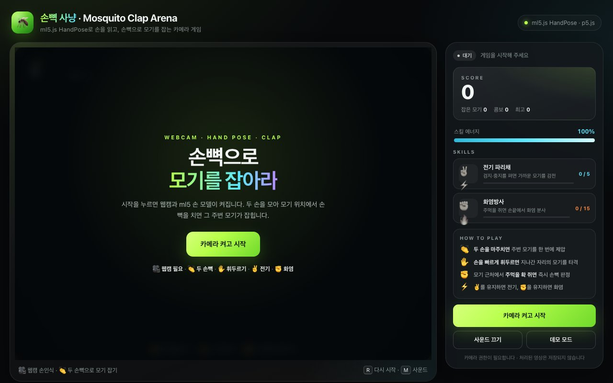

# A반 · 세 번째 바이브 코딩 · 11회차

[전체 아카이브](../../../README.md) · [A반 세 번째 바이브 코딩 체험하기](https://kisoon.github.io/creative-computing-games/?class=A&round=3#collection)

2026년도 2학기 서울예술대학 「창의컴퓨팅2」 수업의 바이브코딩 결과물입니다. 제출된 파일명에 다른 주차가 적혀 있는 경우에도 이번 11회차 제출 묶음 기준으로 분류했습니다.

11개 실행 프로젝트에서 12개 작품을 등록했습니다. 손 인식·카메라 작품은 PC Chrome/Edge와 카메라 권한이 필요하며, 외부 모델을 처음 불러올 때 시간이 걸릴 수 있습니다. 데모가 있는 작품은 카메라 없이도 체험할 수 있습니다.

| 작품 | 실행 화면 |
| --- | --- |
| [LEMON TEN · 레몬 텐](https://kisoon.github.io/creative-computing-games/play.html?game=a-week-02-lemon-ten) 작품 01 마우스 드래그 |  |
| [HAND SIGN PORTAL](https://kisoon.github.io/creative-computing-games/play.html?game=a-week-02-hand-sign-portal) 작품 02 카메라 · 손가락 제스처 / 데모 모드 |  |
| [손바닥 과일 받기](https://kisoon.github.io/creative-computing-games/play.html?game=a-week-02-palm-fruit) 작품 03 카메라 · 손바닥 이동 |  |
| [손 인식 두더지 잡기](https://kisoon.github.io/creative-computing-games/play.html?game=a-week-02-hand-mole) 작품 04 카메라 · 주먹 / 마우스 · Space |  |
| [말랑이 터치](https://kisoon.github.io/creative-computing-games/play.html?game=a-week-02-jelly-touch) 작품 05 카메라 · 손동작 / 마우스 데모 |  |
| [손끝 마법](https://kisoon.github.io/creative-computing-games/play.html?game=a-week-02-fingertip-magic) 작품 06 카메라 · 손동작 / K 시뮬레이션 |  |
| [손바닥 원소 · Hand Elements](https://kisoon.github.io/creative-computing-games/play.html?game=a-week-02-hand-elements) 작품 07 카메라 · 손가락 맞대기 · 손바닥 펼치기 |  |
| [印 · 인술 트레이너](https://kisoon.github.io/creative-computing-games/play.html?game=a-week-02-seal-trainer) 작품 08 카메라 · 손 모양 / 데모 키보드 |  |
| [한정선 찹쌀떡 AR 체험](https://kisoon.github.io/creative-computing-games/play.html?game=a-week-02-mochi-ar) 작품 09 카메라 · 카드 선택 · 체험 시작 · 화면 클릭 |  |
| [하늘빛 풍선 팡팡](https://kisoon.github.io/creative-computing-games/play.html?game=a-week-02-balloon-pop) 작품 10 카메라 · 손끝 이동 (손 인식 후 시작) |  |
| [Pause Pose · 손으로 연주하는 악기](https://kisoon.github.io/creative-computing-games/play.html?game=a-week-02-pause-pose) 작품 11 카메라 · 손동작 · 연주 시작 |  |
| [모기 잡기](https://kisoon.github.io/creative-computing-games/play.html?game=a-week-02-mosquito) 작품 12 카메라 · 손뼉 / 데모 마우스 · Space |  |

