# B반 · 첫 번째 바이브 코딩

[전체 아카이브](../../../README.md) · [첫 번째 바이브 코딩 보기](https://kisoon.github.io/creative-computing-games/?class=B&round=1#collection)

9회차 p5.js Pong 실험입니다. 슬라이드에서 확인한 링크를 중복 제거해 익명 작품별로 묶었습니다. 실명과 슬라이드 회고 원문은 옮기지 않습니다.

스크린샷을 누르면 p5.js 원본 실행 페이지로 이동합니다. GitHub의 Markdown 링크는 클릭 방식에 따라 같은 탭에서 열릴 수 있으므로, **웹 아카이브에서는 모든 프리뷰를 새 창으로 열도록 설정했습니다.**

| 작품 | 작은 실행 화면 및 원본 링크 |
| --- | --- |
| 작품 01 | [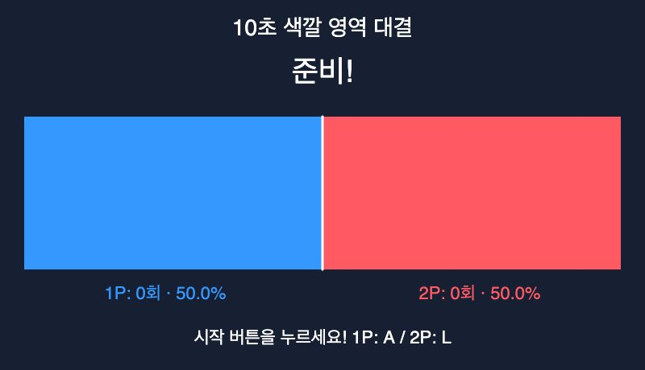](https://editor.p5js.org/esther7459/full/qDGWaJPlW) [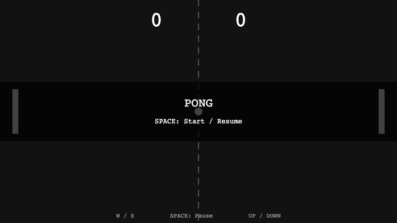](https://editor.p5js.org/esther7459/full/4XpkcYEv5) [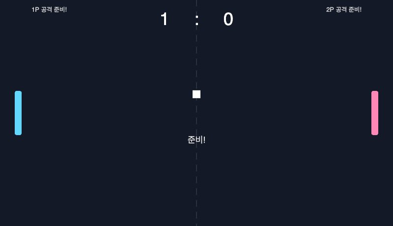](https://editor.p5js.org/esther7459/full/nTEOQ_deg) |
| 작품 02 | [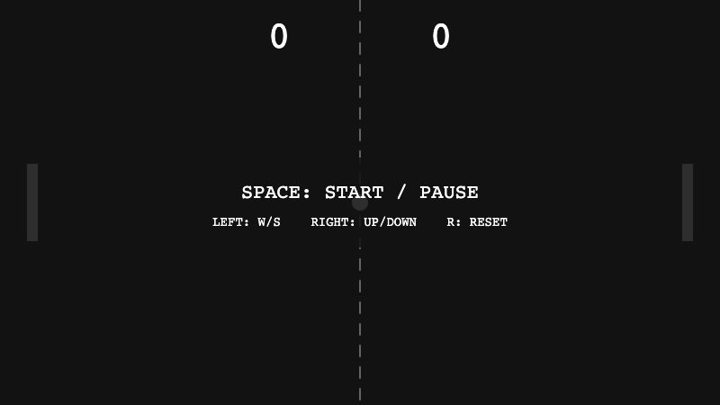](https://editor.p5js.org/twinsjosj/full/hOyRmJ5FX) [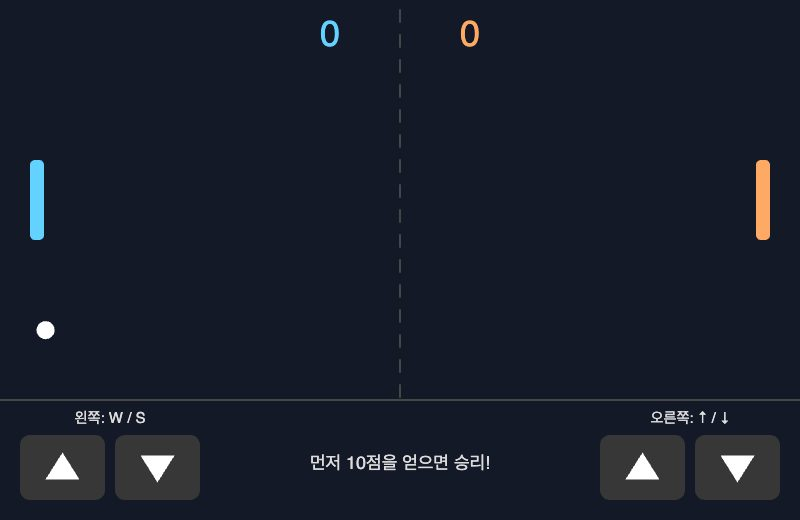](https://editor.p5js.org/twinsjosj/full/CZM3JVDd5) [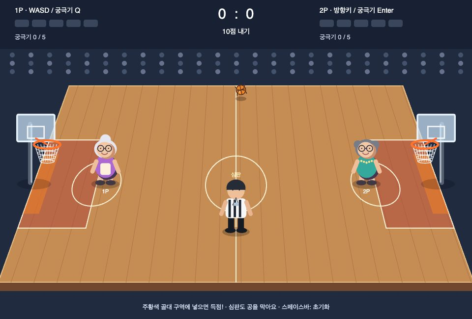](https://editor.p5js.org/twinsjosj/full/iB2IdCfd6) |
| 작품 03 | [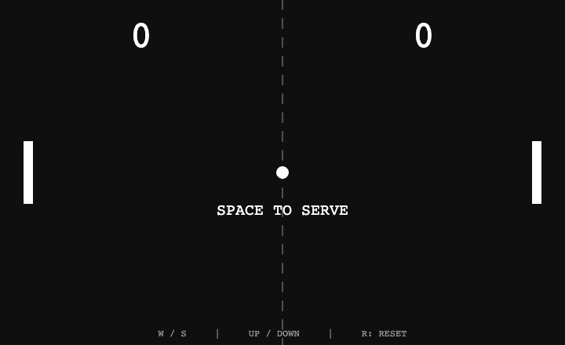](https://editor.p5js.org/zync0309/full/gsG-PP_mMZ) [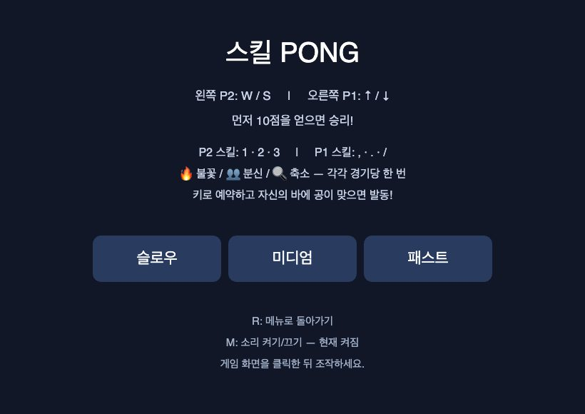](https://editor.p5js.org/zync0309/full/NP8kY3Jt5) |
| 작품 04 | [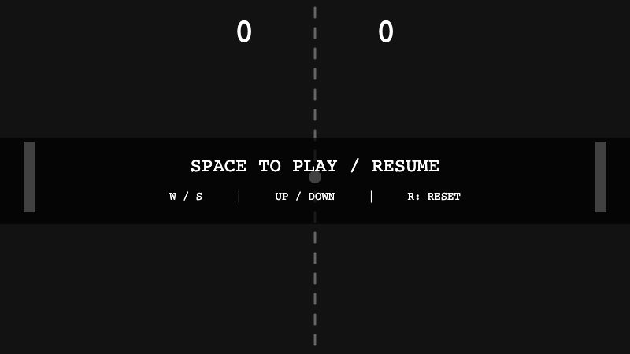](https://editor.p5js.org/dusgh0204/full/A8phj7ytg) [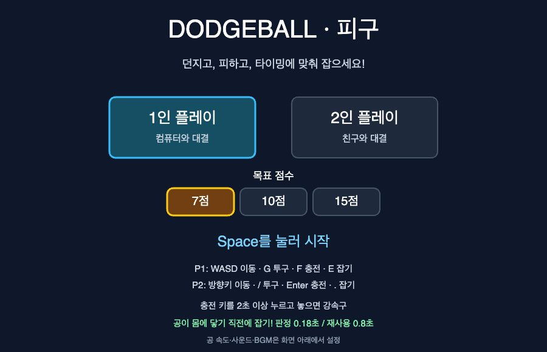](https://editor.p5js.org/dusgh0204/full/zsTib0VFs) |
| 작품 05 | [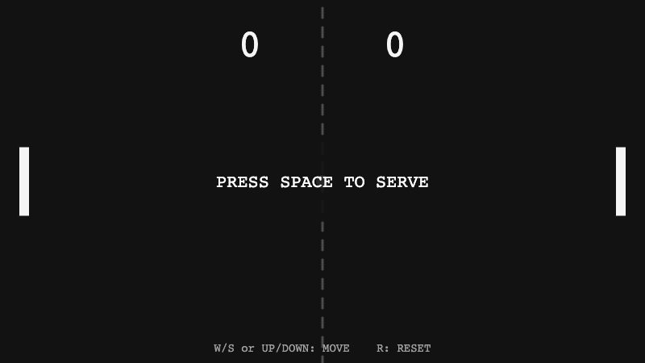](https://editor.p5js.org/pse1207/full/YQj-geO_6) [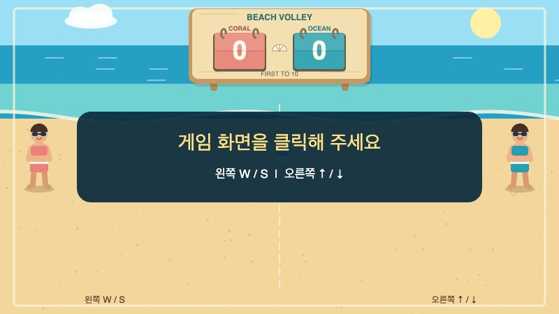](https://editor.p5js.org/pse1207/full/lnDMl3nHq) |

## 실행 화면 확인

B반 12개 링크의 실제 캔버스 화면을 확인하고 캡처했습니다. 원본 p5.js 코드나 작품 표현은 수정하지 않았습니다.
