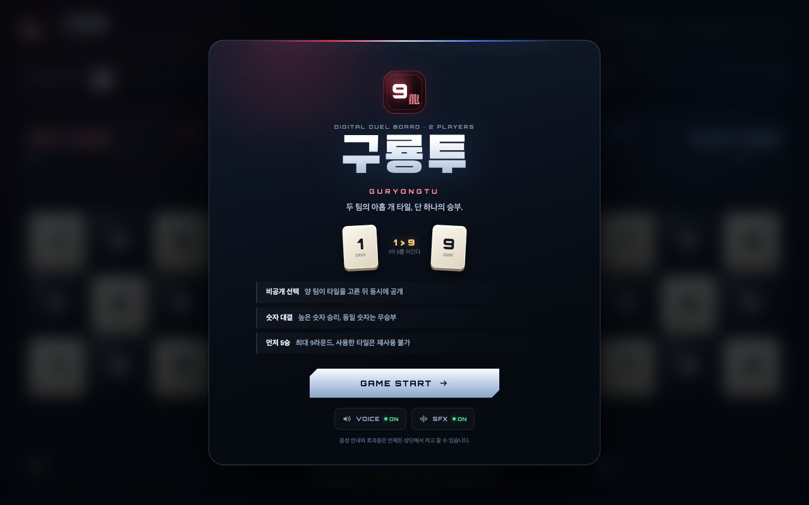
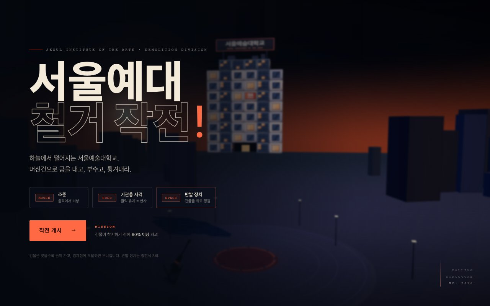
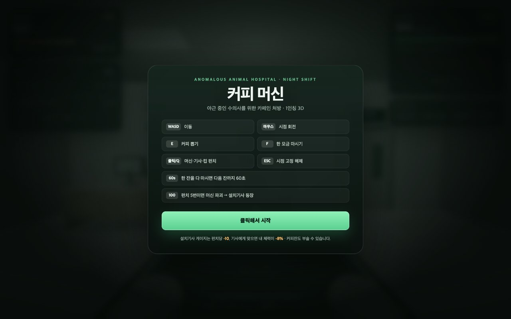
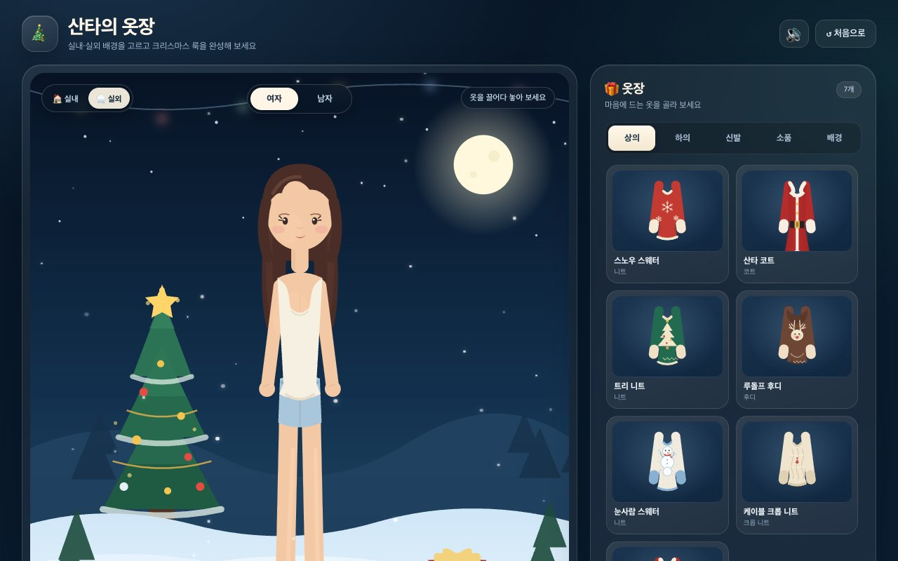
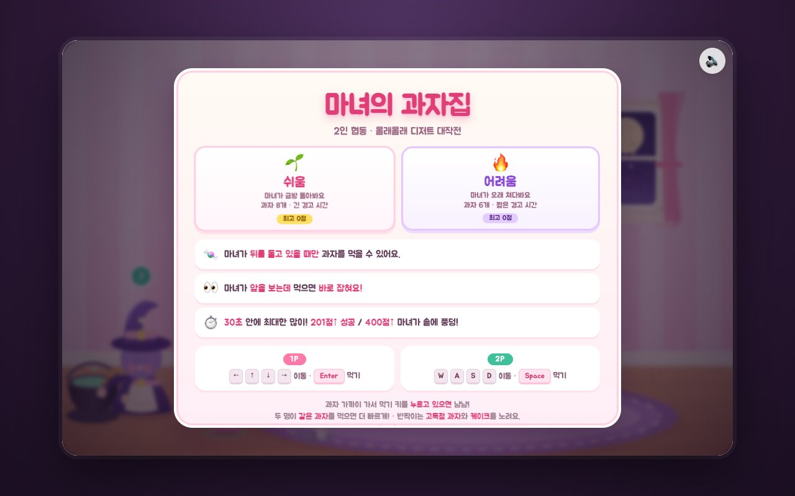
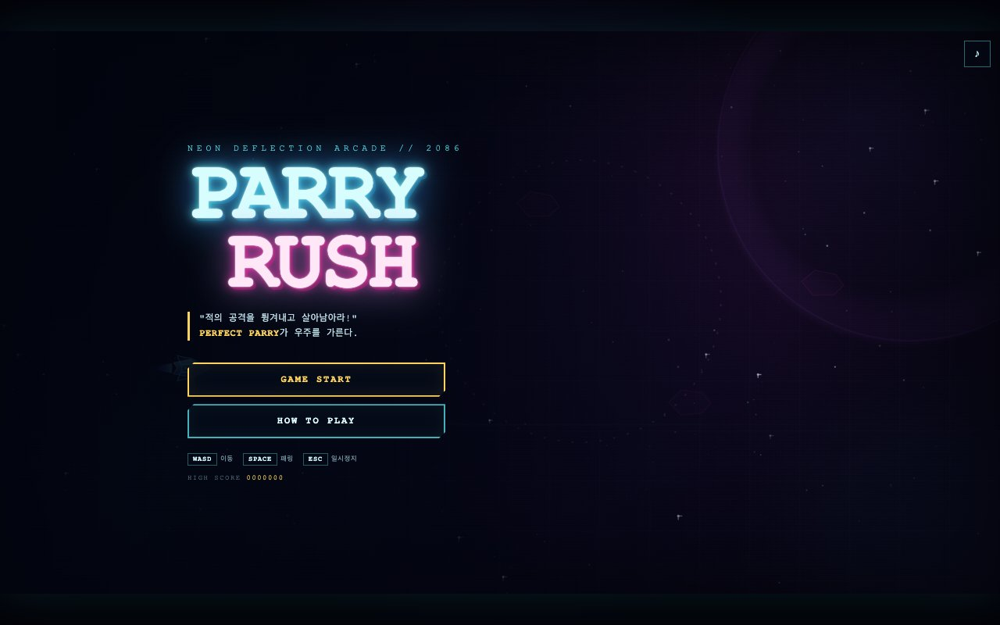

# B반 · 두 번째 바이브 코딩 · 10회차

[전체 아카이브](../../../README.md) · [B반 두 번째 바이브 코딩 체험하기](https://kisoon.github.io/creative-computing-games/?class=B&round=2#collection)

작은 실행 화면을 눌러 작품을 체험해 보세요. 웹 아카이브에서는 새 창에서 열립니다.

| 작품 | 작은 실행 화면 |
| --- | --- |
| [아이 탈출 1 · 감옥 탈출](https://kisoon.github.io/creative-computing-games/play.html?game=b-vibe-02-prison-escape) 작품 01 마우스 클릭 |  |
| [구룡투 · GURYONGTU](https://kisoon.github.io/creative-computing-games/play.html?game=b-vibe-02-guryongtu) 작품 03 마우스 · 타일 선택·확정 |  |
| [JUMP KING](https://kisoon.github.io/creative-computing-games/play.html?game=b-vibe-02-jump-king) 작품 04 ← → · Space 누르기/놓기 · R |  |
| [서울예대 철거 작전](https://kisoon.github.io/creative-computing-games/play.html?game=b-vibe-02-sia-demolition) 작품 05 게임 내 이동·공격 안내 |  |
| [커피 머신 · 변칙성 동물병원](https://kisoon.github.io/creative-computing-games/play.html?game=b-vibe-02-coffee-machine) 작품 06 게임 내 이동·공격·커피 안내 |  |
| [산타의 옷장](https://kisoon.github.io/creative-computing-games/play.html?game=b-vibe-02-santa-closet) 작품 07 마우스 클릭·드래그 |  |
| [마녀의 과자집](https://kisoon.github.io/creative-computing-games/play.html?game=b-vibe-02-witch-house) 작품 08 게임 내 2인 키보드 안내 |  |
| [PARRY RUSH](https://kisoon.github.io/creative-computing-games/play.html?game=b-vibe-02-parry-rush) 작품 09 WASD 이동 · Space 패리 · Esc 일시정지 |  |
