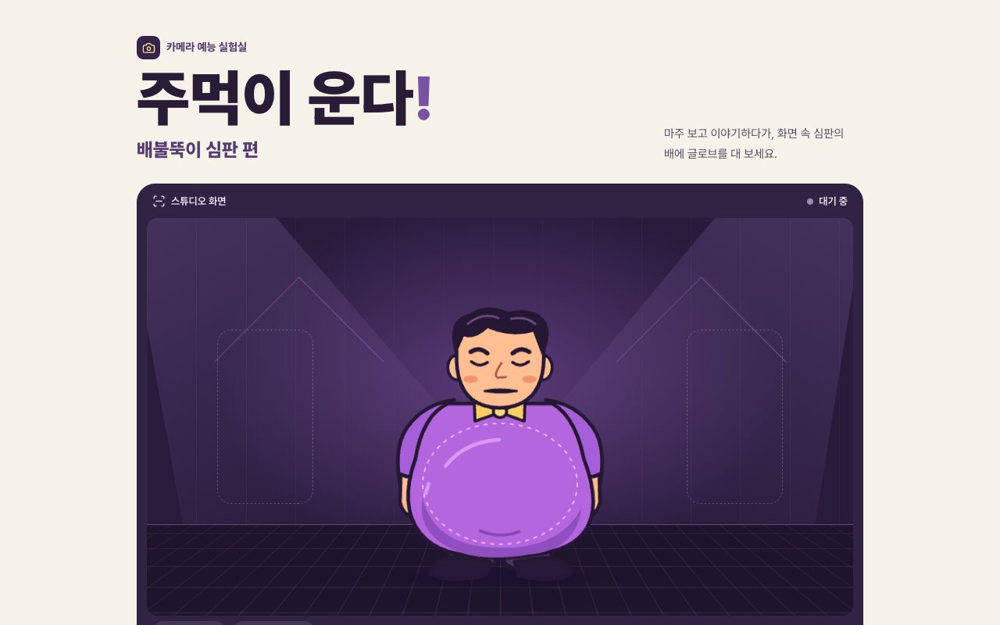
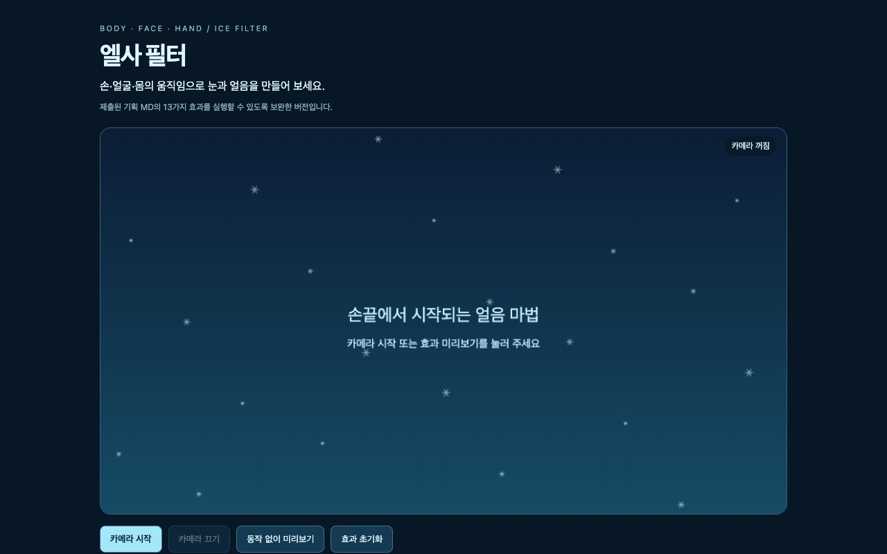

# B반 · 세 번째 바이브 코딩 · 11회차

[전체 아카이브](../../../README.md) · [B반 세 번째 바이브 코딩 체험하기](https://kisoon.github.io/creative-computing-games/?class=B&round=3#collection)

학생 실명과 학번은 공개하지 않고 제출 순서의 작품 번호로 표시합니다. 작은 이미지는 실제 실행 화면이며, 웹 아카이브에서는 새 창에서 열립니다.

| 작품 | 작은 실행 화면 |
| --- | --- |
| [NINJUTSU LOCAL](https://kisoon.github.io/creative-computing-games/play.html?game=b-vibe-03-ninjutsu) 작품 01 카메라 · 수인 학습 / 데모 모드 |  |
| [IMPRO SCRIPT 6](https://kisoon.github.io/creative-computing-games/play.html?game=b-vibe-03-impro-script) 작품 02 카메라 · 기록 시작/종료 · 희곡 생성 |  |
| [주먹이 운다 · 배불뚝이 심판](https://kisoon.github.io/creative-computing-games/play.html?game=b-vibe-03-referee) 작품 03 카메라 · 두 사람의 손목 움직임 |  |
| [엘사 필터](https://kisoon.github.io/creative-computing-games/play.html?game=b-vibe-03-elsa-filter) 작품 04 · **MD 기반 실행 보완** 카메라 · 신체 동작 / 효과 미리보기 |  |
| [Mirror & Move](https://kisoon.github.io/creative-computing-games/play.html?game=b-vibe-03-mirror-move) 작품 05 카메라 시작 · 색상 팔레트 |  |
| [터치라인 · 라이브캠 리프팅](https://kisoon.github.io/creative-computing-games/play.html?game=b-vibe-03-touchline) 작품 06 카메라 · 손가락 맞대기 / 공 내리기 |  |
| [움직임이 남는 거울](https://kisoon.github.io/creative-computing-games/play.html?game=b-vibe-03-ink-mirror) 작품 07 카메라 · 검지 이동 / 테스트 선 그리기 |  |
| [HandPose · 잡초와 토벌](https://kisoon.github.io/creative-computing-games/play.html?game=b-vibe-03-weed-battle) 작품 08 · **MD 코드 복원** 카메라 · 손 펴기/주먹/검지 튕기기 |  |

## 11회차 보완 내역

- 작품 03: 제출 묶음 안의 완성된 정적 웹 빌드를 사용했습니다. 별도 서버나 관리 화면을 새로 만들지 않았습니다.
- 작품 04 「엘사 필터」: 실행 코드가 없고 [기획 MD](../../../games/b/week-02/elsa-filter/PROJECT.md)만 있어, 손·얼굴·몸 인식과 13가지 효과를 바탕으로 실행판을 보완했습니다. 원본 코드가 없는 만큼 화면 구성과 효과의 구체적인 모양은 이 보완판에서 구현한 해석이며, 학생이 완성해 제출한 실행 화면으로 간주하지 않습니다. 작품 카드에도 **MD 기반 실행 보완**을 표시합니다.
- 작품 06: 제출된 단일 HTML 실행판을 사용했습니다.
- 작품 08: [MD의 코드](../../../games/b/week-02/weed-battle/PROJECT.md)에서 HTML·CSS·JavaScript 블록을 추출해 실행 파일로 복원했습니다. 수치·색상·동작은 그 코드를 기준으로 유지합니다.

카메라 작품은 권한 허용과 외부 모델 로딩이 필요합니다. 실제 손·얼굴·몸의 인식 정확도는 조명·카메라·사용 환경에 따라 달라집니다.

[원본 대조 및 검증 기록](VERIFICATION.md)
