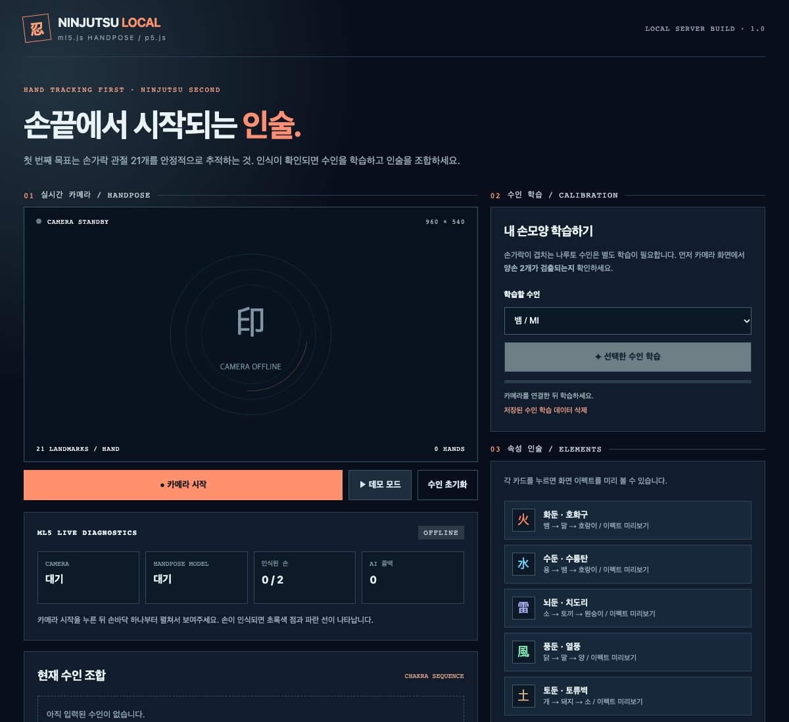
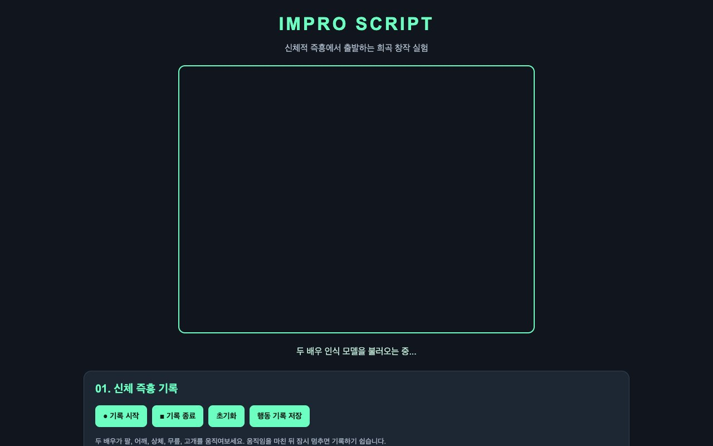
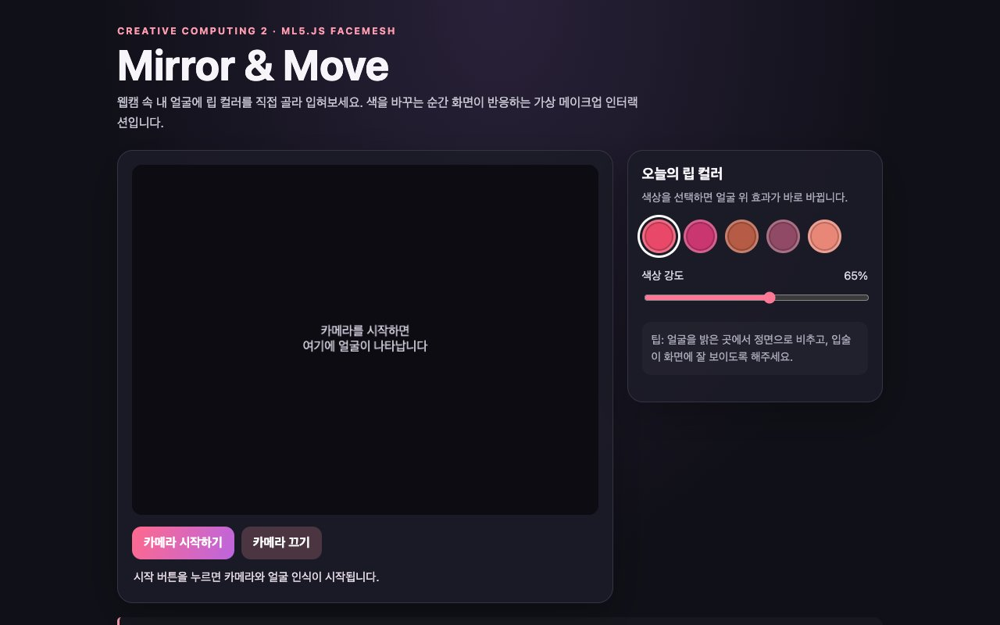
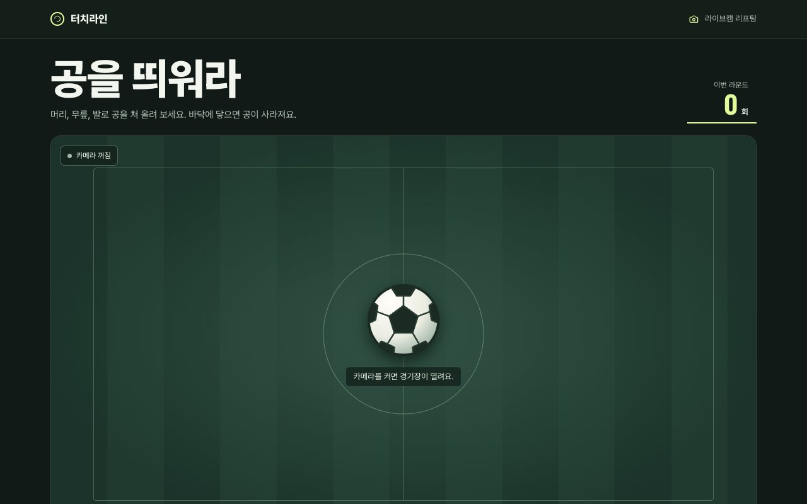
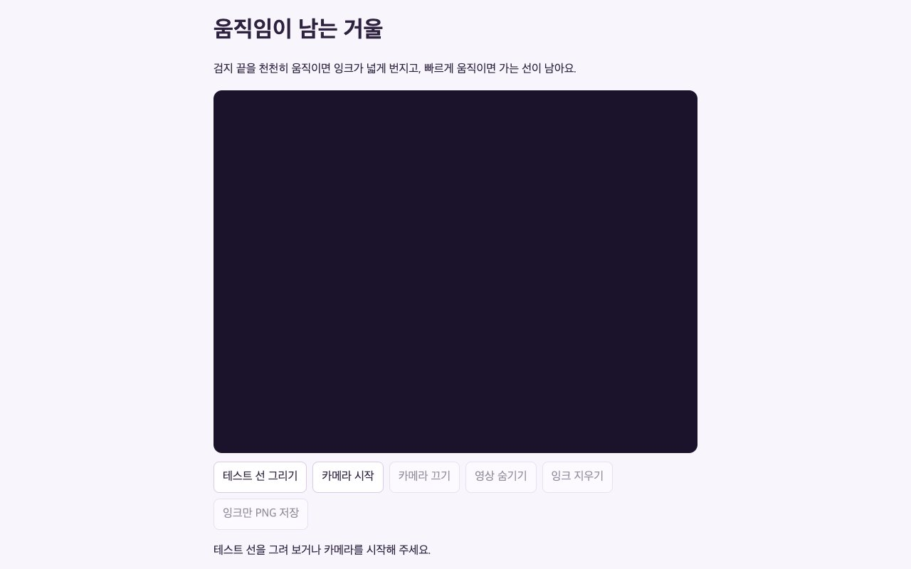
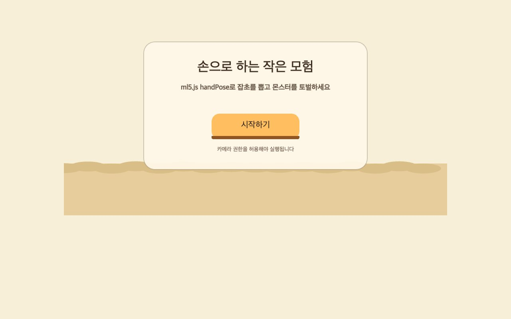

# B반 · 세 번째 바이브 코딩 · 11회차

[전체 아카이브](../../../README.md) · [B반 세 번째 바이브 코딩 체험하기](https://kisoon.github.io/creative-computing-games/?class=B&round=3#collection)

작은 실행 화면을 눌러 작품을 체험해 보세요. 웹 아카이브에서는 새 창에서 열립니다.

| 작품 | 작은 실행 화면 |
| --- | --- |
| [NINJUTSU LOCAL](https://kisoon.github.io/creative-computing-games/play.html?game=b-vibe-03-ninjutsu) 작품 01 카메라 · 수인 학습 / 데모 모드 |  |
| [IMPRO SCRIPT 6](https://kisoon.github.io/creative-computing-games/play.html?game=b-vibe-03-impro-script) 작품 02 카메라 · 기록 시작/종료 · 희곡 생성 |  |
| [주먹이 운다 · 배불뚝이 심판](https://kisoon.github.io/creative-computing-games/play.html?game=b-vibe-03-referee) 작품 03 카메라 · 두 사람의 손목 움직임 |  |
| [엘사 필터](https://kisoon.github.io/creative-computing-games/play.html?game=b-vibe-03-elsa-filter) 작품 04 · 기획안 기반 체험판 카메라 · 신체 동작 / 효과 미리보기 |  |
| [Mirror & Move](https://kisoon.github.io/creative-computing-games/play.html?game=b-vibe-03-mirror-move) 작품 05 카메라 시작 · 색상 팔레트 |  |
| [터치라인 · 라이브캠 리프팅](https://kisoon.github.io/creative-computing-games/play.html?game=b-vibe-03-touchline) 작품 06 카메라 · 손가락 맞대기 / 공 내리기 |  |
| [움직임이 남는 거울](https://kisoon.github.io/creative-computing-games/play.html?game=b-vibe-03-ink-mirror) 작품 07 카메라 · 검지 이동 / 테스트 선 그리기 |  |
| [HandPose · 잡초와 토벌](https://kisoon.github.io/creative-computing-games/play.html?game=b-vibe-03-weed-battle) 작품 08 카메라 · 손 펴기/주먹/검지 튕기기 |  |
