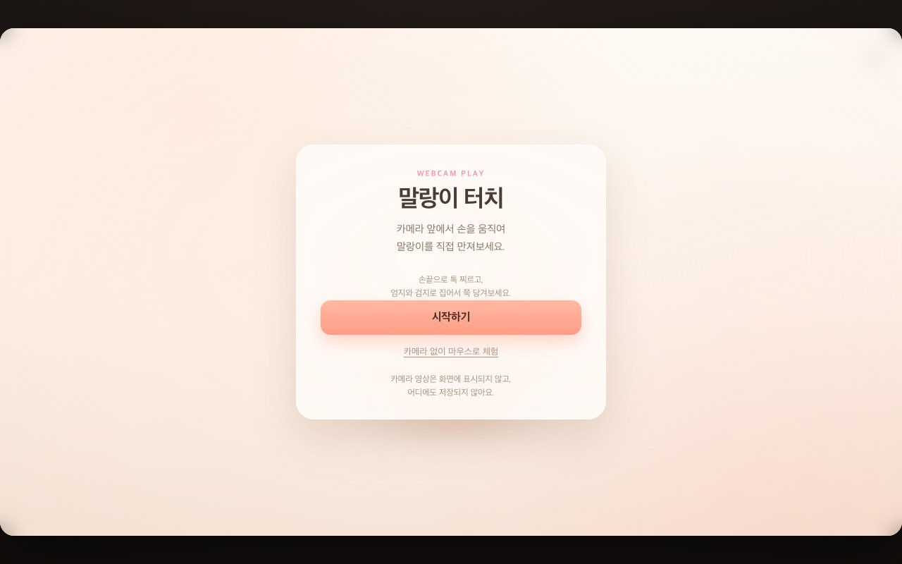

# 말랑이 터치 (MVP)

카메라에 손을 비추면 화면 속 말랑이가 손을 따라 찌그러지고, 만질 때마다 소리가 나는 웹 토이입니다.
[ml5.js](https://ml5js.org/) `handPose()`로 손 21개 관절을 인식합니다.



## 실행

빌드 도구가 필요 없습니다. 정적 파일 서버만 있으면 됩니다.

```bash
# 이 폴더에서
python3 -m http.server 5173
```

브라우저에서 <http://localhost:5173> 을 엽니다.

> 카메라는 `localhost` 또는 `https://` 에서만 동작합니다. `file://` 로 열면 안 됩니다.
> Chrome / Edge 데스크톱을 권장합니다.

### 마우스 데모

카메라가 없거나 권한을 줄 수 없을 때는 시작 화면의 **"카메라 없이 마우스로 체험"** 을 누르거나
<http://localhost:5173/?demo=1> 로 접속하세요. 마우스(터치) 위치를 손가락으로 바꿔서 똑같이 놀 수 있습니다.

## 놀이 방법

1. **시작하기** → 카메라 권한 허용
2. 처음 한 번은 손 인식 모델(수 MB)을 내려받기 때문에 몇 초 걸립니다.
3. 손을 화면에 보이면 자동으로 시작됩니다.
4. 손끝이나 손바닥으로 말랑이를 누르고 문질러 보세요.

- **D** 키: 손 인식 디버그(관절 점, 콜라이더, FPS)
- **M** 키: 소리 켜기/끄기
- 카메라 영상은 **화면에 표시되지 않고 저장되지도 않습니다.**

## 폴더 구조

```
.
├─ index.html
├─ styles.css
├─ vendor/
│  └─ ml5.min.js          # ml5.js 1.4.0 (로컬 내장)
├─ src/
│  ├─ main.js             # 상태 머신 + 메인 루프
│  ├─ config.js           # 모든 튜닝 값
│  ├─ input/
│  │  ├─ camera.js        # getUserMedia, 숨겨진 <video>
│  │  ├─ handTracker.js   # ml5.handPose 래퍼
│  │  └─ landmarks.js     # 좌표 변환 + 미러링 + 스무딩 + 콜라이더
│  ├─ physics/
│  │  ├─ jelly.js         # 소프트바디(96정점 스프링 메시)
│  │  └─ oneEuroFilter.js # 손 떨림 제거
│  ├─ render/
│  │  ├─ renderer.js      # 배경/몸통/접촉 표시/디버그
│  │  ├─ face.js          # 눈, 입, 볼, 깜빡임
│  │  └─ effects.js       # 하트/반짝이 파티클
│  ├─ audio/
│  │  └─ squish.js        # Web Audio 절차적 "말랑" 사운드
│  └─ ui/
│     └─ screens.js       # 시작/로딩/에러 오버레이
├─ test/
│  ├─ hand-test.html      # ml5 손 인식 단독 테스트
│  └─ hand.jpg            # 테스트용 손 이미지
└─ project.md             # 기획서
```

## 손 인식 동작 방식

```
카메라 프레임
  → 숨긴 <video> → 내부 캔버스에 복사 (백엔드 호환성)
  → ml5.handPose().detectStart(canvas)  (비동기 콜백, 21 keypoints × 최대 2손)
  → 비디오 픽셀 좌표를 캔버스 좌표로 변환 (좌우 미러링은 여기서만)
  → One Euro Filter 로 스무딩 + 속도 계산
  → 손끝 5개 + 손바닥 1개를 원형 콜라이더로 변환
  → 말랑이 정점과 충돌 → 표면을 안쪽으로 밀어 움푹 들어가게
  → 스프링으로 원래 모양 복원 + 변형량에 맞춰 소리/표정
```

- ml5 옵션의 `flipped`는 쓰지 않습니다. ml5 런타임에 따라 동작이 달라질 수 있어서
  `landmarks.js`에서 `x = videoWidth - x`로 한 번만 뒤집습니다.
- ml5 keypoints는 **정규화 값이 아니라 비디오 픽셀 좌표**입니다.
- 추론은 ml5가 자체 루프로 돌리고, 렌더 루프는 마지막 결과만 읽습니다.
  결과가 420ms 이상 오래되면 손이 사라진 것으로 처리합니다.

### WebGPU 관련 주의 (실제 겪은 버그)

Chrome의 tf.js **WebGPU 백엔드는 `<video>` 요소를 입력으로 주면 손을 0개로 반환**하는 경우가 있습니다.
(같은 장면을 캔버스로 넘기면 정상 인식)

그래서 `handTracker.js`는 두 가지를 함께 합니다.

1. `ml5.setBackend("webgl")`을 먼저 시도합니다. (실패하면 기본 백엔드로 진행)
2. 백엔드와 무관하게 안전하도록, 카메라 프레임을 **내부 캔버스에 복사한 뒤 그 캔버스로 추론**합니다.

## 튜닝

`src/config.js` 한 곳에서 조절합니다.

| 값 | 의미 |
| --- | --- |
| `jelly.radiusRatio` | 말랑이 크기 (캔버스 높이 대비) |
| `jelly.spring` / `damping` | 탄성 / 감쇠. damping을 낮추면 더 출렁임 |
| `jelly.vertices` | 외곽 정점 수 (많을수록 부드럽고 느림) |
| `hand.tipRadiusRatio` | 손끝 판정 반경 |
| `filter.*` | 스무딩 강도 |
| `audio.masterGain` | 전체 음량 |
| `audio.cooldownMs` | 같은 손에서 소리가 반복되는 최소 간격 |

## 테스트

**손 인식 단독 테스트** — 카메라 없이 정적 이미지로 ml5 파이프라인을 확인합니다.

<http://localhost:5173/test/hand-test.html>

관절 21개가 그려지고, 콘솔/화면에 인식 결과(신뢰도, 좌표)가 출력되면 정상입니다.

**앱 경로 통합 테스트** — 손 사진을 가짜 카메라 스트림으로 흘려서
`HandTracker` → 좌표 변환 → 콜라이더까지 실제 앱과 같은 경로를 확인합니다.

<http://localhost:5173/test/tracker-test.html>

"성공: 앱 경로에서 손 인식됨"이 뜨면 정상입니다.

## 문제 해결

| 증상 | 확인 |
| --- | --- |
| "카메라 권한이 필요해요" | 주소창의 카메라 아이콘에서 허용. `https://` 또는 `localhost`인지 확인 |
| "손 인식 모델을 불러오지 못했어요" | 첫 실행 시 모델 가중치를 네트워크에서 받습니다. 인터넷 연결 확인 |
| 손이 인식되지 않음 | 밝은 곳에서 손 전체(손목 포함)를 화면에 보이게. 그래도 안 되면 `D` 키로 디버그 확인 (손 개수/FPS) |
| 소리가 안 남 | 브라우저 탭을 한 번 클릭(자동재생 정책), 설정의 소리 토글 확인 |
| 손이 늦게 따라옴 | 다른 무거운 탭을 닫고, `handPose.modelType`을 `"lite"`로 유지 |

## 크레딧

- 손 인식: [ml5.js](https://ml5js.org/) 1.4.0 (`handPose`, MIT)
- 사운드: Web Audio API 절차적 합성 (외부 음원 없음)
- 아트: 코드로 그린 오리지널 블롭 (이미지 에셋 없음)
